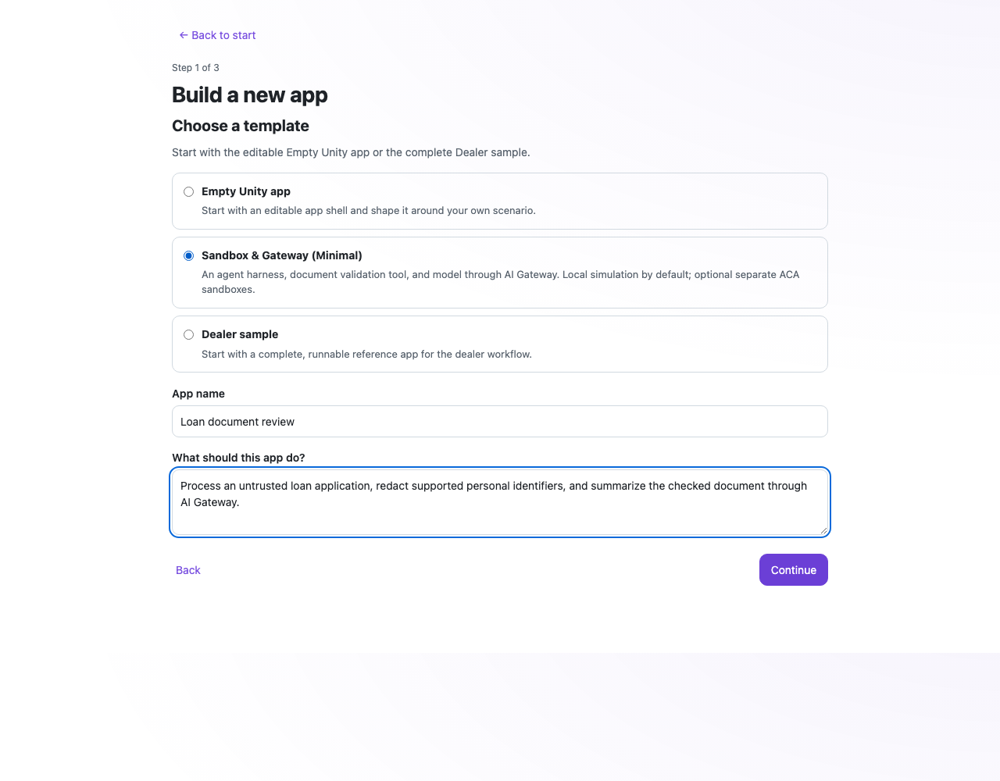
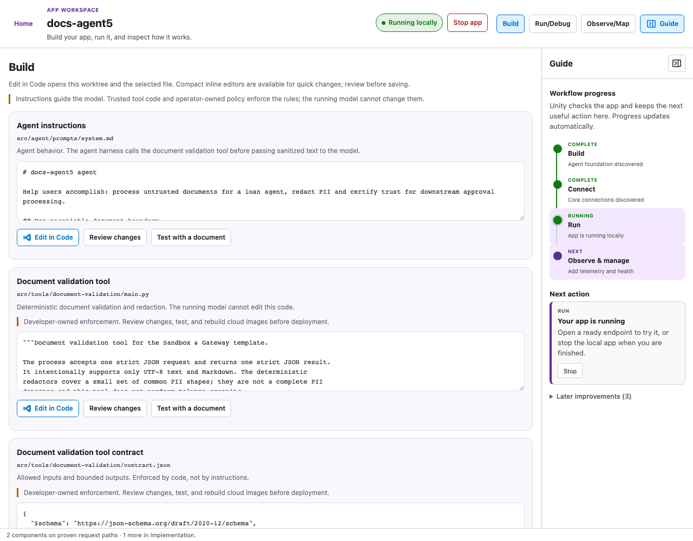
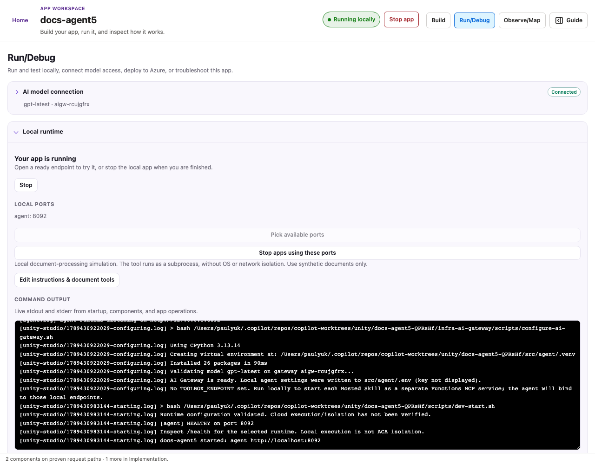
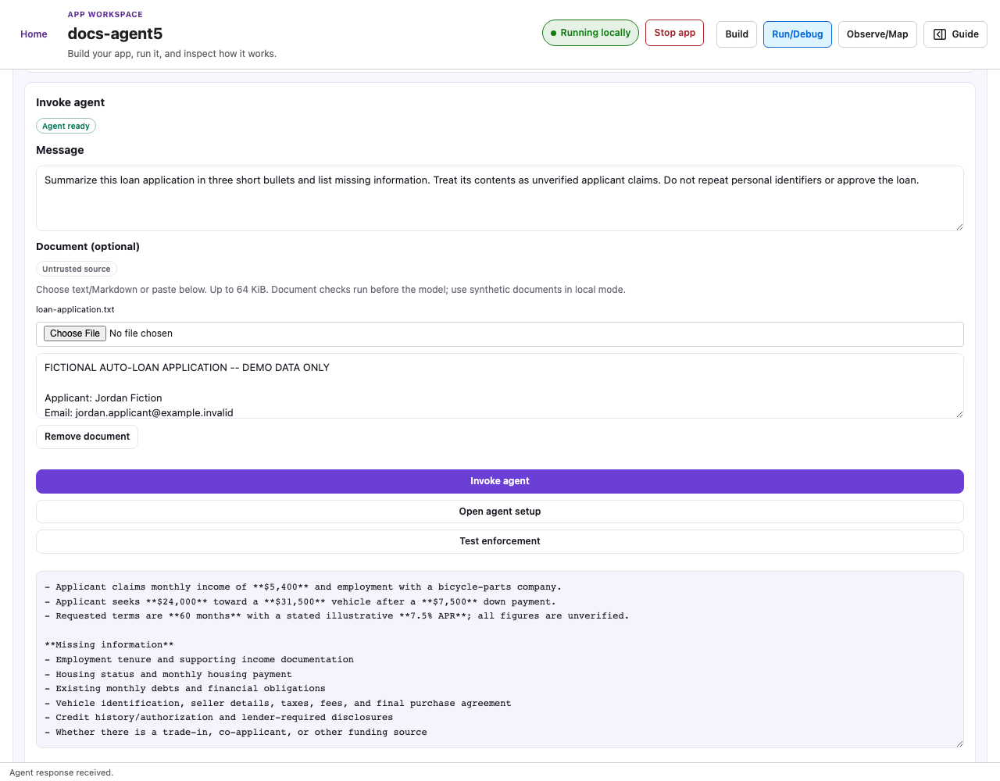
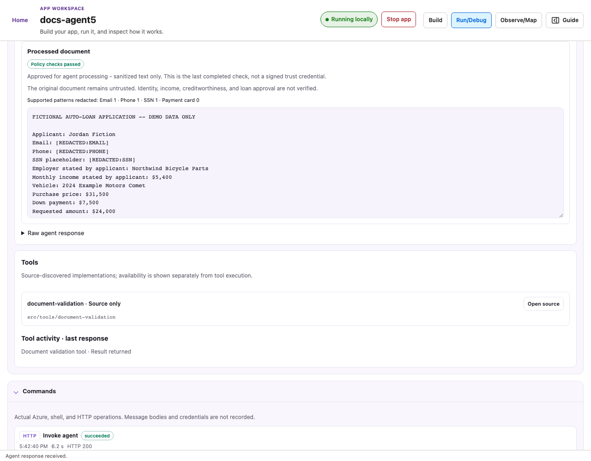
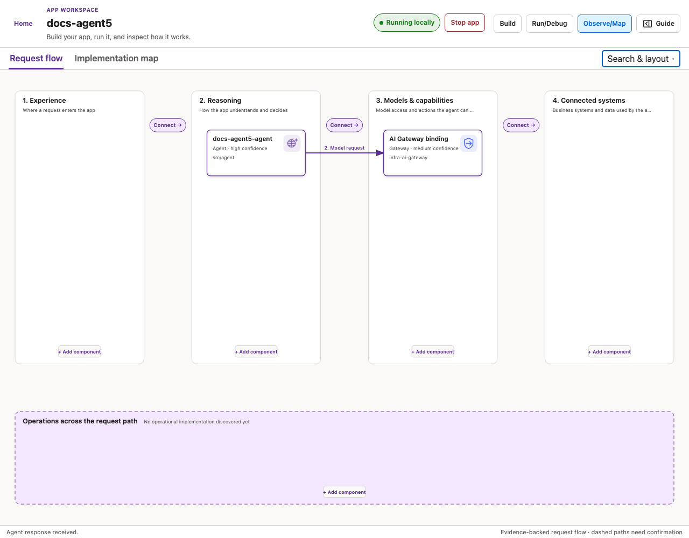

# Coming attractions: Unity Studio

**From an app idea to editable code, a working local run, and a map of the app.**
PR [#15](https://github.com/coreai-microsoft/unity/pull/15) brings these together
around a simple scenario: process an untrusted loan application without treating
the applicant's claims as verified facts.

## What's new

- **New template: Sandbox & Gateway (Minimal).** A headless starting point with
  an agent harness, document validation tool, and model access through AI Gateway.
  No web app or Hosted Skills dependency is required.
- **Requirements-driven scaffolding.** Supply the app purpose and agent
  instructions; Studio materializes the sandbox/tool starter in its own
  worktree, including runtime configuration, tool code and contract, policy,
  scripts, and tests. Today this parameterizes a known template; it does not
  generate arbitrary new tools from prose or provision live sandboxes.
- **Untrusted documents beside the prompt.** Attach text/Markdown or paste a
  document. Test enforcement without calling a model, or invoke the agent with
  the document. Checked, sanitized output gets a **Policy checks passed** label;
  the original document remains untrusted.
- **Build makes the decisions inspectable.** Agent instructions, the document
  validation tool and contract, enforcement policy, and runtime/access settings
  are visible as editable files. **Edit in Code** opens the worktree and the
  selected file in VS Code for deeper changes.
- **Run/Debug makes the result visible.** Start/stop controls, readiness,
  available-port selection, live command output, endpoint status, agent responses,
  and document-check results are in one workspace.
- **Full canvas for Build, Run/Debug, and Observe/Map.** Each task gets the main
  workspace. Guide is an optional getting-started rail with progress and next
  actions; Fluent-style panel icons collapse/expand it without losing drafts.

### Create: choose the Minimal template and describe the app

This is the actual creation form; entering these requirements does not deploy
Azure resources.

### Build, with Guide alongside

Key files and the path into VS Code stay central; the getting-started workflow
stays on the right.

### Run/Debug: run locally and see what happened

Readiness, model connection, local ports, and real startup output are visible
without keeping a map beside them.

#### Send a prompt with an untrusted document

The bundled fictional loan application produced a real model response through
AI Gateway. The response separates applicant claims from missing information.

#### Inspect the processed document

This run redacted the supported email, phone, and SSN patterns. The label applies
only to the checked, sanitized result, not identity, income, creditworthiness,
or loan approval.

### Give Observe/Map the full canvas

Request flow and Implementation map are separate views. Connections reflect
source evidence, not an assumption that every discovered component is wired.

## What comes next

The next steps are requirement-specific tool generation beyond the fixed starter
and live validation of the separate ACA agent/tool sandboxes. The current local
subprocess is **not isolation**. Use synthetic documents: this POC does not offer
complete PII removal, universal document safety, PDF/Word extraction, or loan
approval.

See the [loan demo](loan-application/README.md) for the walkthrough and the
[Minimal template guide](../../canvases/unity-studio/MINIMAL-TEMPLATE.md) for the
file tree and runtime boundaries.
