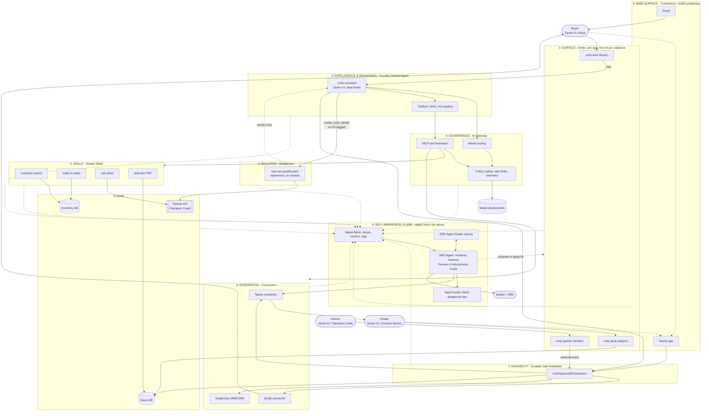
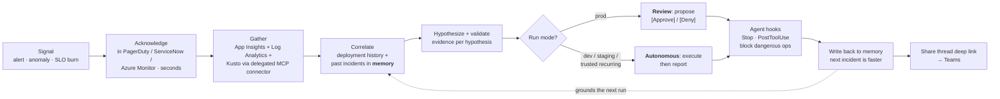
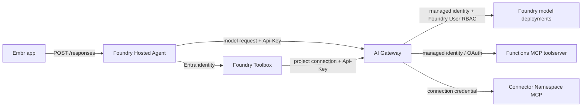

# Azure App Platform: The Self-Aware App Platform

Azure App Platform brings together Azure's modern serverless and AI-native building blocks—with **ACA Sandboxes** as the focal primitive—into one coherent, end-to-end application platform: a fast web front end, a reasoning agent, governed model access, callable skills, isolated compute for sensitive work, durable workflows, and integration into Microsoft 365. It's opinionated about how these pieces fit together so a team can ship a real, production-shaped app quickly, instead of re-deriving the architecture each time.

The defining trait of a Unity app is that **it watches itself**. Observability, diagnosis, and safe self-healing are wired into the platform from day one via **SRE Agent**, attached across every tier: front end, agent, skills, sandboxes, connectors, workflows, and data. A Unity app can explain what's wrong with itself in plain language, correlate a symptom against its own deployment history and incident memory, and propose (or, under policy, take) a corrective action. It's a plane that spans the whole architecture, the same way the whiteboard sketch drew "SRE" as a band underneath everything else.

Alongside self-awareness sits **environment safety**: identity, isolation, and egress control enforced outside the agent's reach, not inside its prompt. Every boundary carries a real identity (user, managed, or agent), sensitive work runs in a sandbox that can't see its own controls, and network egress is default-deny rather than allow-listed after the fact. This is the same safety model Azure SRE Agent itself was rebuilt around, and Unity applies it to every tier, not just the ops agent.

The third pillar is a **uniform interface**: every capability is reachable as an API with a published spec, a generated SDK, an MCP server, and a CLI, so a human and an agent use the same door. That consistency is what makes the agent developer experience whole, not an afterthought bolted onto a human-first API.

**Car buying is Demo #1.** It's a great showcase because a car purchase naturally exercises every tier of the platform with a real, non-contrived job to do: a conversational agent to find a car, a sensitive financial calculation that belongs in an isolated sandbox, a durable multi-step approval, and a handoff to human partners over Teams and email. Each piece already had a job before the demo existed; the demo just makes it visible.

---

## 1. Platform, then demo

Unity is the constant. Demos are how we prove it out. Demo #1 (car buying) is built entirely from Unity's existing platform capabilities and does not introduce anything new. If a demo ever needs something the platform doesn't have, that's a platform gap to add to Unity itself, not a one-off hack in the demo.

### 1.1 Unity's platform capabilities

| # | Capability | Unity's answer |
|---|---|---|
| 1 | **Surface: web front end.** The main app the customer uses | **Embr** |
| 2 | **Surface: Microsoft 365 integration.** Meeting the customer and partner in Teams and email, not just a browser tab | Deep integration via **Connectors**, with automatic **Microsoft 365 (A365) publishing** |
| 3 | **Intelligence & Reasoning.** A stateful, long-lived, code-owned agent with its own identity | **Foundry Hosted Agents** |
| 4 | **Governance.** One choke point for every model and tool call | **AI Gateway** |
| 5 | **Skills.** Deterministic domain capabilities the agent calls, scale-to-zero | **Hosted Skills** (skills the agent invokes as tools) |
| 6 | **Isolation.** Run sensitive or untrusted computation with no residue | **Sandboxes** (ephemeral, strongly isolated compute) |
| 7 | **Integration.** Reach systems of record without hand-rolled OAuth | **Connectors** |
| 8 | **Durability.** Multi-step, human-in-the-loop workflows that survive failure | **Durable Task Scheduler / Durable Functions** |
| 9 | **Self-awareness** ⭐. The app observes, diagnoses, and repairs itself | **SRE Agent**, spanning every other tier |
| 10 | **Builder experience.** Build, govern, and operate the platform from inside Copilot | **Cloud Foundation canvases** (per-service studios, built for GitHub Copilot App and designed to also run in Claude Desktop) |

Cloud Foundation has already shipped canvases that map closely onto these tiers: a studio for building skills, a studio for governing the AI Gateway and starting a Foundry hosted agent, and a studio for operating the SRE Agent. Unity's devex is therefore already partly built. The canvases are the platform's own authoring and operating surface.

### 1.2 Identity: Entra everywhere, used differently front and back

Every boundary in Unity assumes **Entra ID**. What differs is *which* identity is used at each boundary:

- **Front end (web client, Teams, email):** the signed-in **user's identity**, flowing via **on-behalf-of (OBO)** delegation so downstream calls carry the buyer's or dealer's own permissions. Never a shared app-only credential.
- **Agent and back-end services (Foundry agent, skills, sandboxes, workflows):** dedicated **managed identity** and **agent identity**. Each hosted agent gets its own Entra Agent ID, distinct from any human user, so its actions are independently auditable.

This split (user/OBO at the edge, managed/agent identity in the back end) is itself a demo-worthy Unity pattern, not just plumbing.

### 1.3 Environment safety: the environment is the policy, not the prompt

Identity answers "who is acting." Sandboxing and egress control answer the harder question: "what can that action actually reach." Unity treats both as one safety story, grounded in how Azure SRE Agent itself was rebuilt to run safely at scale (see [Restricting the Environment: How We Rebuilt Azure SRE Agent for AI Safety](https://commandline.microsoft.com/azure-sre-agent-restricting-environment-ai-safety/)). The core lesson from that work: a prompt can tell an agent what it should do, but only the environment can guarantee what it's able to do. So Unity enforces safety outside the agent's reach, not inside its instructions.

This shows up in Unity as four concrete, demoable layers:

- **Sandboxing separates reasoning from execution.** The Foundry Hosted Agent's own reasoning loop runs in a trusted runtime; anything it generates or executes (model-authored code, tools, the loan pre-qualification calculation) runs in a separate, hardware-isolated microVM (**Sandboxes**, built on ACA Sandboxes). The agent has full control inside the sandbox but cannot see or modify the provisioning, policy, or credential machinery that governs it, because that machinery doesn't share its filesystem.
- **Credentials are used, never possessed.** Tools inside a sandbox (a loan-rate lookup, a call to a partner API) authenticate through normal SDK paths (`az`, HTTP clients) but receive a short-lived, single-use, destination-locked handle rather than a real credential. An egress proxy outside the sandbox performs the actual token exchange. A secret or connection string can never sit in the sandbox's filesystem, memory, or logs waiting to be read back out.
- **Egress is default-deny, not allow-listed after the fact.** The loan pre-qualification sandbox in Demo #1 can reach exactly one destination (the credit partner API) and nothing else. A prompt injection or a bug can't turn that into an arbitrary outbound call, because the network boundary doesn't consult the prompt.
- **Approval is risk-classified, not just gated on "read vs. write."** Whether an action needs a human depends on the operation, its target, and the evidence behind it, not a blanket rule. The Unity approval workflow (Durable Task Scheduler) and the SRE Agent's own run modes (Review vs. Autonomous) both follow this pattern: routine, low-risk, well-evidenced actions proceed; anything touching a critical target or resting on weak evidence stops for a person.

Demo #1 makes this tangible on stage: attempt an outbound call from inside the loan pre-qualification sandbox to somewhere other than the one allowed partner endpoint, and show it blocked at the network boundary rather than caught by a prompt instruction. That single moment demonstrates identity, isolation, and egress control together, the same three ideas Azure SRE Agent's own safety redesign converged on.

### 1.4 Uniform interface: every capability is API, SDK, spec, MCP server, and CLI

Unity's platform capabilities are only real if a builder or an agent can actually reach them without reading source code first. So every capability in the table above ships the same five interfaces, not just whichever one its team found convenient:

- **API** - a real HTTP endpoint with request/response semantics, versioned like any other service.
- **API spec** - an OpenAPI (or equivalent) document, published and kept in sync with the API, so both people and tools can generate clients against it instead of guessing.
- **SDK** - a typed client library in at least the languages Unity's own services use, generated from the spec where possible so it never drifts.
- **MCP server** - the same capability exposed as MCP tools and resources, so an agent (Unity's own hosted agent, a builder's IDE agent, or a third party) can discover and call it the same way a human calls the API.
- **CLI** - a command-line surface for the same operations, for scripting, CI, and the moments an engineer just wants to run one command instead of writing code.

This is what makes Unity's agent developer experience whole. A builder can read the spec, generate the SDK, script the CLI, and wire the MCP server into an agent, all against the same underlying capability, with no special case for "the parts that are agent-friendly" versus "the parts that are human-friendly." The Cloud Foundation canvases (§1.1, capability 10) are themselves a client of this uniform interface: `sre-agent-studio` talks to SRE Agent's API and MCP surface, not a bespoke integration.

Every tier in §2 should be read with this lens: Hosted Skills, AI Gateway, Sandboxes, Connectors, Durable Task Scheduler, and SRE Agent each earn a row in a future "interface completeness" checklist (API, spec, SDK, MCP server, CLI), and any gap is a platform gap to close, the same way a missing capability would be.

---

## 2. Architecture

Unity's opinions, in one picture: the platform decides identity, governance, isolation, durability, and observability so a team's own code stays down to the workflow and domain logic.

### 2.1 Unity reference architecture, with the self-awareness plane spanning everything

The self-awareness plane at the bottom is not a separate service off to the side. It watches every tier above it, the same way the whiteboard drew "SRE" as one band underneath everything.

### 2.2 The self-aware loop (detail)

Every step above is documented behavior, not aspiration: *"Acknowledges the alert… Queries your observability tools… Correlates with deployment history… Checks memory for similar issues: 'We saw this exact error three weeks ago. Here's what fixed it.'… Forms hypotheses… Proposes a fix or resolves autonomously based on your run mode"* ([incident-response](https://learn.microsoft.com/en-us/azure/sre-agent/incident-response)).

### 2.3 Agent request path (mirrors the verified reference sample)

Direct adaptation of `Azure-Samples/simple-foundry-hosted-agent-python-aigateway:IMPLEMENTATION_NOTES.md` ("Request path"), which states: *"The agent does not call a Foundry model endpoint directly. This keeps model traffic behind AI Gateway policies. `FoundryChatClient` is intentionally not used for model inference."*

### 2.4 Sandbox & Gateway Pattern: Progressive Reference Architecture

The **Sandbox & Gateway pattern** provides a lean, modular blueprint for building agentic cloud applications on Azure. It prioritizes a minimal core building block that can be progressively expanded with durability, human approval, evaluation suites, and self-aware observability.

#### 1. Minimal Building Blocks
The simplest standalone building blocks has no dedicated front end: it's triggered by an **HTTP REST** call or a **Timer** schedule, runs interchangeable host compute (App Service, Azure Functions, or Azure Container Apps) for the Agent Loop, offloads tool execution to **ACA Sandboxes** ([sandboxes.azure.com](https://sandboxes.azure.com/docs)) enforcing a PII safety boundary, routes any sandbox outbound call through a **secure egress proxy** to a single allow-listed destination, and sends model egress through **AI Gateway (APIM)**.

#### 2. Minimal + Turn-Level Durability & Human-In-The-Loop (HITL)
Adding the **Durable Task System (DTS / Durable Functions)** introduces turn-level state checkpointing and automatic recovery for long-running workflows. It enables **Human-In-The-Loop (HITL)** approval flows (e.g. Teams / Email) that pause execution without keeping host compute active. Secure egress from ACA Sandboxes remains in place, unchanged from the minimal pattern.

#### 3. Minimal + SRE Observability & Continuous Evals
Integrating **Continuous Evals** and the **SRE Agent Observability Band** provides real-time reasoning quality checks, OpenTelemetry trace correlation, and automated health monitoring across compute, sandboxes, and gateway layers.

#### 4. Complete Architecture
Bringing together interchangeable Host Compute, ACA Sandboxes with secure egress, AI Gateway, DTS / Durable Workflows with HITL, Hosted Skills, and SRE Observability into one unified application architecture. Here the sandbox's secure egress path targets a concrete destination — an **M365 / SharePoint connector** — showing how sensitive sandboxed work can safely reach a Microsoft 365 system of record.

---

## 3. Narrative: Demo #1 end to end

Nir's canonical flow for the car-seller agent: search and discover a car, get a price quote, get the customer's email, get financing, a human approves the deal in Teams, and the email goes back to the customer. The walkthrough below follows that exact sequence, tier by tier.

**1. Maya opens the buyer app and starts a conversation.** `driveline-web` is an Embr project: one `embr.yaml` declares the TypeScript frontend, the API, managed Postgres, and Redis, and Embr infers the rest: *"Embr makes the application the primitive and infers the infrastructure. Push code, and Embr detects the framework, builds it, provisions the environment, and deploys"* (`coreai-microsoft/paas-serverless-product:planning/startup-cloud/Embr_Value_Prop.md:13`). The manifest surface is shipped today (`platform`, `run`, `database`, `cache`, `static`, `healthCheck`: `embr-roadmap.md:107`), as are PR preview environments with real per-environment databases (`embr-roadmap.md:104`; `app_plat_gna_base:product/embr/01-one-pager.md:17-18`). The app streams chat to the **deal-finder** Foundry Hosted Agent over the Responses protocol: the documented default for *"Conversational chatbot or assistant"* because *"the platform manages conversation history, streaming events, and session lifecycle"* ([hosted-agents.md](https://github.com/MicrosoftDocs/azure-ai-docs/blob/main/articles/foundry/agents/concepts/hosted-agents.md)). Maya's session gets a VM-isolated sandbox with a persistent `$HOME`, so closing the tab doesn't lose her shortlist: *"Each session gets a dedicated sandbox with a persistent filesystem (`$HOME` and `/files`), enabling scale-to-zero with stateful resume."* From the very first request, spans are flowing into the self-awareness plane.

**2. The agent finds cars and quotes a price using Skills, and every model and tool call is governed.** "EV under $38k, 250+ miles, room for a car seat" triggers the `inventory-search` skill: an Azure Functions app on the serverless agents runtime, where *"Capabilities are configured first, with code when you need it… remote MCP servers, MCP servers hosted in connector namespaces, skills, and sandboxed code executions"* ([serverless agents runtime](https://learn.microsoft.com/en-us/azure/azure-functions/functions-serverless-agents-runtime)), on Flex Consumption so it scales to zero between shoppers. The agent never touches a model or tool directly: reasoning goes to `<gateway>/default/models/openai/v1/chat/completions`, tools go **agent → Foundry Toolbox → AI Gateway → MCP toolserver**: the exact shape proven in `Azure-Samples/simple-foundry-hosted-agent-python-aigateway:repo_digest_agent.py` (`_gateway_client()`, `_github_toolbox()`). That indirection is the governance story: the gateway *"Authenticates the runtime access key… Evaluates the policies… Routes the request… Returns the response and emits telemetry"* ([AI Gateway overview](https://learn.microsoft.com/en-us/azure/api-management/ai-gateway-overview)), with content safety and token limits configured as **cards, not XML**. A second Skill assembles the quote (an **Offer**: vehicle, price, and terms) once Maya narrows to one car. The demo swaps `gpt-latest` → `gpt-mini-latest` for cheap filter turns with zero code change, because routing is on the `model` field.

**3. The agent gets the customer's email so the deal can come back to her later.** Before financing starts, the conversation captures Maya's email address as part of the deal record, durable in the same session state DTS is already tracking. This is the detail that lets the flow *end* somewhere concrete: the offer, and later the final decision, both have an address to land on, and Maya can close the tab and pick up where she left off.

**4. Financing: PII goes into a Sandbox and nothing else comes out.** "What would my monthly payment be?" is the hinge. Instead of putting Maya's income and identifiers into the conversation store, the agent provisions an **ACA Sandbox**. Sandboxes are *"fast, secure, ephemeral compute environments"* with *"Strong isolation: Each sandbox runs in its own secure boundary, safe for untrusted code execution"* and *"Scale to zero"* ([sandboxes-overview](https://learn.microsoft.com/en-us/azure/container-apps/sandboxes-overview)). Three documented properties make this a real control, not theater: **strong isolation** (blast radius), **egress policy**: *"domain-based allow or deny rules, CIDR-based network rules, and VNet integration"*: so the sandbox can reach the lender's soft-pull endpoint and *literally nothing else, not even the app's own database*, and **auto-delete** after stop. It returns `{credit_band, max_apr, monthly_payment, term_months}` and nothing more. Raw PII never enters Embr Postgres, never enters a model prompt, and never enters telemetry: and AI Gateway *"payload capture is disabled"* in the reference infra (`IMPLEMENTATION_NOTES.md`), so transcripts stay clean too. **Self-awareness note:** the sandbox emits *lifecycle* events only (created / executed / deleted, with duration and exit code): never payloads. The SRE Agent can therefore diagnose "prequal sandboxes are timing out" without ever being exposed to what they computed. That separation is itself a demo beat.

**5. A human approves the deal in Teams, backed by a durable workflow.** Maya taps "Apply," and a **Durable Task Scheduler**-backed orchestration takes over: the textbook human-interaction pattern: *"The orchestrator calls an activity to notify a person… starts a durable timer and simultaneously waits for an external event… If the person responds before the timer fires, the orchestrator processes the response. If the timer fires first, the orchestrator handles the timeout"* ([human interaction pattern](https://learn.microsoft.com/en-us/azure/durable-task/common/durable-task-human-interaction)). DTS gives *"durable execution… fault-tolerant… automatic retries and state persistence"* in an isolated resource for fault isolation ([DTS](https://learn.microsoft.com/en-us/azure/durable-task/scheduler/durable-task-scheduler)). We deliberately kill the Functions app mid-approval and watch it resume. Azure Functions' own docs point exactly here: for *"Long-running, multi-step orchestration with human-in-the-loop approvals"* the better option than the agent runtime is **Durable Functions**: so having both is following guidance, not padding.

**6. The email goes back to the customer, and Connectors close the loop into the dealership's real world.** The orchestrator's notify activities are **Connector Namespace** calls: *"a fully managed integration service… hosts a catalog of prebuilt, reusable connectors… SharePoint, Salesforce, SAP, and Outlook"* handling *"Authentication and credential management… Polling and webhook delivery… Retry, throttling, and error handling"* ([Connector Namespace overview](https://learn.microsoft.com/en-us/azure/connector-namespace/connector-namespace-overview)). An adaptive card lands in the Contoso Motors Teams channel for approval, then once the dealer signs off, the Email connector sends the final offer to the address Maya gave in step 3, and the lead writes into the DMS. Reverse direction matters too: a **connector trigger** fires when a vehicle sells so inventory never goes stale: Functions exposes this as a first-class `connectorTrigger` binding ([managed connectors in Functions](https://learn.microsoft.com/en-us/azure/azure-functions/functions-connectors-overview)). Meanwhile the dealer works in `driveline-desk` and the lender in `driveline-lender`, two more Embr projects on the same deals database: which is Embr's whole pitch: *"it runs the whole application… as one deployable unit"* (`product/embr/13-unified-positioning.md`).

**7. ⭐ The app notices it is sick, explains why, and fixes itself.** Saturday evening, traffic spikes. The `trade-in-value` skill starts returning 500s. Nobody pages anyone. The **Azure SRE Agent** attached to the Unity resource groups acknowledges within seconds, then does what the docs describe: queries Application Insights and Log Analytics; pulls the AI Gateway's `gen_ai.*` token-limit metric; correlates against the deployment event from the Embr push two hours earlier; and checks **memory**: *"We saw this exact error three weeks ago. Here's what fixed it."* ([incident-response](https://learn.microsoft.com/en-us/azure/sre-agent/incident-response)). It forms and validates a hypothesis: a token rate-limit policy card tightened in the last change is throttling the follow-up model call after tool execution: and, because this is production, **Review mode** applies: it posts a proposal with `[Approve] [Deny]` rather than acting ([run modes](https://learn.microsoft.com/en-us/azure/sre-agent/run-modes)). An **agent hook** on `PostToolUse` has already audited every tool call the agent made and would have blocked anything destructive ([agent hooks](https://learn.microsoft.com/en-us/azure/sre-agent/agent-hooks)). The on-call engineer approves from a Teams thread deep link. In the staging environment, the identical response plan is set to **Autonomous** and the same fix applies itself with no human in the path. The engineer never opened the portal: they were in **SRE Agent Studio**, the Cloud Foundation Copilot canvas that *"pulls a Resource Health snapshot and opens an SRE Agent investigation thread pre-seeded with that context"* and can *"correlate an ICM / S360 ticket"* by pasting a ticket id (`coreai-microsoft/canvases-cloud-foundation:canvases/sre-agent-studio/README.md`, "What you can do"): or equivalently from any MCP client, because the `sreagent_*` tools ship in `@azure/mcp`. **This is what "self-aware app" means, and it is the closing beat of the demo.**

**8. The loop closes and the platform gets smarter.** The investigation is written back to memory, so the next occurrence resolves faster; *"Unlike runbooks, your agent learns from every incident… Runbooks go stale; your agent's memory grows smarter"* ([incident-response](https://learn.microsoft.com/en-us/azure/sre-agent/incident-response)). A **scheduled task** runs a nightly health sweep across all nine Unity tiers. And because Unity's tiers are constant across verticals, everything the SRE Agent learned about *how Unity fails* transfers to Demo #2 on day one: the memory, the response plans, the hooks, and the connector wiring are platform assets, not car-buying assets.

---

## 4. JTBD table

Read left-to-right: the **Unity platform JTBD** is the vertical-agnostic job; the **Demo #1 instance** is how it shows up in car buying. Any future vertical replaces only the fourth column.

| Service | What it is (1 sentence, cited) | Unity platform JTBD (vertical-agnostic) | Demo #1 instance (car buying) | Why this JTBD is a good fit (not contrived) |
|---|---|---|---|---|
| **Unity** *(platform framing)* | "Where all our modern serverless paas and cloud foundation assets come together for a more complete and productive end to end app platform" (`coreai-microsoft/unity:README.md:2`). | **"Prove that Cloud Foundation's assets compose into one coherent app platform: and prove it more than once, with interchangeable demo verticals over an unchanged substrate."** | Car buying is Demo #1; the platform tiers are frozen and only domain skills/data/copy change for Demo #2. | A single demo proves a scenario; two demos on the same substrate prove a *platform*. The design rule ("a vertical may not introduce a new platform component") turns each vertical into a falsifiable test of the platform rather than a bespoke build. |
| **Embr** | An "agent-native application platform on Azure: a PaaS where the unit of deployment is *the whole application that includes an agent*… rather than the agent alone" (`coreai-microsoft/app_plat_gna_base:product/embr/01-one-pager.md:5`). | **"Ship N differentiated audience-specific experiences over one shared data model, from one repo, with a real preview environment per pull request."** | `driveline-web` (buyer), `driveline-desk` (dealer), `driveline-lender` (partner) over shared inventory/deals Postgres. | The scenario genuinely has three distinct audiences and three UIs plus shared data: exactly the "whole app, not just the agent" shape Embr claims and the only tier that covers it. Per-PR real databases (`01-one-pager.md:17`) let a UI change be demoed in a preview URL without touching the main demo. |
| **Foundry Hosted Agents** | "Containerized agentic AI applications that run on Agent Service… your own code packaged as a container image" with per-session VM-isolated sandboxes and a dedicated Entra agent identity ([hosted-agents.md](https://github.com/MicrosoftDocs/azure-ai-docs/blob/main/articles/foundry/agents/concepts/hosted-agents.md)). | **"Be the long-lived, stateful reasoning core: hold a multi-session conversation, decide which skill to call, and resume with full context: under a distinct auditable identity."** | The **deal-finder** assistant: shortlist → test drive → trade-in → financing, across ~2 weeks. | Car buying is inherently multi-session and stateful. The documented `$HOME`/`/files` persistence and *"stateful resume"* is precisely the capability that requires; a stateless chat endpoint fails the scenario. The per-agent Entra ID also answers "who pulled this credit report." |
| **Foundry Toolbox + Skills** | A Skill is "a `SKILL.md` file that you author once and store centrally in Foundry through the versioned Skills API," attachable to a toolbox where MCP clients see it as an MCP Resource ([Foundry skills](https://learn.microsoft.com/en-us/azure/foundry/agents/how-to/tools/skills)). | **"Hold policy and behavioral guidance as versioned, centrally-promoted artifacts so non-engineers can change agent behavior without a redeploy."** | Dealership negotiation policy: max discount, doc-fee disclosure rules, when to escalate to a human. | This is the doc's own motivating problem verbatim: *"When you embed these guidelines in each agent's system prompt or code, you create duplication. If the policy changes, you update and redeploy every agent."* Auto-lending disclosure rules are a literal instance. Immutable versions + `default_version` promotion = a crisp demo beat with zero deploys. |
| **Azure Functions "Hosted Skills"** *(serverless agents runtime / MCP tools)* | A programming model "for building event-driven AI agents as Azure Functions apps… You define agents in `.agent.md` files, configure tools and runtime defaults alongside your project," with `tools/` and `skills/` folders, on Flex Consumption ([serverless agents runtime](https://learn.microsoft.com/en-us/azure/azure-functions/functions-serverless-agents-runtime)). | **"Implement deterministic, high-frequency, spiky domain capabilities as governed tools that scale to zero: and react to system-of-record events."** | `inventory-search`, `trade-in-value`, `rate-sheet`, `deal-doc`; plus a connector-triggered reindex when a car sells. | Inventory search is called dozens of times per conversation, is pure deterministic logic over a DB, and is spiky (weekend evenings). Flex Consumption's scale-to-zero is the right economic answer, and the docs explicitly steer deterministic tool endpoints here rather than into the agent. |
| **AI Gateway (APIM AI Gateway tier)** | "A fully managed gateway for AI workloads… one place to publish, secure, govern, and observe access to AI models and Model Context Protocol (MCP) tools" ([AI Gateway overview](https://learn.microsoft.com/en-us/azure/api-management/ai-gateway-overview)). | **"Be the single governed choke point for all model and tool traffic: per-tenant budgets, content safety on prompts *and* tool arguments, provider credentials hidden from apps, and one audit trail."** | Per-dealer token budgets; safety on the "vehicle description" free-text field; mini-model routing for cheap turns. | Auto lending is regulated and adversarial (fair-lending rules; prompt injection via free-text listing fields). Content-safety-on-tool-arguments and token rate limits map 1:1. Per-tenant budgets are a natural multi-tenant SaaS requirement. Proven end-to-end in the reference sample. |
| **ACA Sandboxes (ADC)** | "Fast, secure, ephemeral compute environments… a first-class resource type (`Microsoft.App/SandboxGroups`)" with strong isolation, configurable egress allow/deny, and auto-delete ([sandboxes-overview](https://learn.microsoft.com/en-us/azure/container-apps/sandboxes-overview)). | **"Run the one computation in the app that touches regulated/sensitive data inside a disposable, network-locked boundary, and return only a verdict: so the sensitive data never reaches persistent stores, prompts, or telemetry."** | Loan pre-qualification: income + identifiers + soft credit pull in, `{credit_band, apr, payment}` out, sandbox destroyed. | The strongest JTBD on the board. It uses *three* documented properties for one coherent purpose: isolation (blast radius), **egress deny-all-but-one-host** (can't exfiltrate to the app's own store), auto-delete (no residue). The alternative: prequal in the main app: is a design a real fintech would reject, so the problem isn't invented. Bonus: Embr already uses ADC sandboxes as substrate for managed Postgres (`embr-roadmap.md:113`), giving a "same primitive, two altitudes" story. |
| **Connector Namespace** | "A fully managed integration service… hosts a catalog of prebuilt, reusable connectors… Each connector exposes… event triggers, actions… and AI agent tools," and can publish connectors as managed MCP servers ([Connector Namespace overview](https://learn.microsoft.com/en-us/azure/connector-namespace/connector-namespace-overview)). | **"Reach the systems of record the business actually runs on: bidirectionally: without writing an OAuth refresh loop for any of them."** | Teams adaptive card to dealer; Outlook offer email to buyer; Salesforce/Dataverse DMS write + sell-event trigger. | Dealerships are a canonical "system of record is someone else's SaaS" domain. The doc's own scenario table names Salesforce lead triggers and Outlook read/send as headline examples. Two-directional use makes it structural, not a bolt-on notifier. |
| **Durable Task Scheduler + Durable Functions** | "Durable execution in Azure… a fault-tolerant approach to running code that handles failures and interruptions through automatic retries and state persistence" ([DTS](https://learn.microsoft.com/en-us/azure/durable-task/scheduler/durable-task-scheduler)); human-interaction races a durable timer against an external event ([pattern](https://learn.microsoft.com/en-us/azure/durable-task/common/durable-task-human-interaction)). | **"Own multi-day, human-in-the-loop business transactions that must not be lost across redeploys, restarts, or regional blips."** | Loan approval: submit → notify underwriter → wait ≤48h → auto-escalate on timeout → approve/decline. | Loan approval *is* the archetypal multi-day human-in-the-loop workflow. Functions' own docs route this scenario away from the agent runtime toward Durable Functions, so this is following stated guidance. "Kill the app mid-approval, watch it resume" is a dramatic and honest beat. |
| **⭐ Azure SRE Agent** *(the self-awareness plane)* | "Azure SRE Agent safely automates operational work and reduces toil… It connects your observability tools, incident platforms, and source code repositories into a single automated workflow… The agent proposes changes and your team approves. No change deploys without human sign-off." ([overview](https://learn.microsoft.com/en-us/azure/sre-agent/overview)). It is an ARM resource, `Microsoft.App/agents`, with its own data plane at `https://<name>--<hash>.<region>.azuresre.ai` (`coreai-microsoft/canvases-cloud-foundation:canvases/sre-agent-studio/README.md`). | **"Make the application self-aware: continuously monitor every Unity tier, auto-diagnose a failure by correlating telemetry with deployment history and prior-incident memory, explain it in natural language, and propose or apply a bounded corrective action: as part of the app's own architecture, reachable from the builder's IDE."** | Detects `trade-in-value` 5xx during a Saturday spike; correlates the AI Gateway token-limit metric + Functions cold starts + the Embr deploy 2h earlier; recalls the same failure from 3 weeks ago in memory; proposes the policy-card rollback in **Review** mode for prod (auto-applies in staging); posts a thread deep link into the dealer Teams channel; writes the finding back to memory. Also runs a nightly scheduled health sweep across all nine tiers, and correlates a pasted ICM/S360 ticket. | This demo is genuinely distributed across five compute boundaries with **separate telemetry sinks by design**: the reference infra deliberately gives *"the agent and Gateway… separate Log Analytics workspaces"* (`IMPLEMENTATION_NOTES.md`). Cross-boundary correlation is therefore a real, structural pain the architecture creates, not one we invented. It is the **"SRE" band spanning the whole whiteboard**. Every documented capability maps: incidents, memory, connectors, scheduled tasks, run modes, hooks, sub-agents, workflows. And Cloud Foundation *already owns the front door*: `sre-agent-studio` can *"Diagnose a failing app… correlate an ICM/S360 ticket… manage incidents, scheduled tasks, connectors, memories, and workflows"* (`canvases/sre-agent-studio/README.md`), so we're dogfooding our own asset rather than bolting on a third-party ops tool. |
| **SRE Agent Studio canvas + Azure MCP `sreagent_*`** | A GitHub Copilot App canvas that discovers `Microsoft.App/agents`, diagnoses App Service/Function App/Container App failures, correlates ICM/S360 tickets, and manages incidents/tasks/connectors/memories/workflows (`coreai-microsoft/canvases-cloud-foundation:canvases/sre-agent-studio/README.md`); grounded in the same surface the Azure MCP Server's `sreagent_*` tools expose ([blog](https://techcommunity.microsoft.com/blog/appsonazureblog/access-your-sre-agent-from-any-ide-terminal-or-ai-assistant/4523434)). | **"Put the self-awareness plane inside the builder's existing loop: editor, terminal, or AI assistant: so operating the platform never requires leaving the tool where code is being written."** | The Phase-5 demo beat is performed entirely from the Copilot canvas: no Azure portal tab is opened on stage. | The blog's own thesis: *"Your SRE Agent stops being a destination you visit and becomes part of how your team works every day."* Using our own canvas (rather than the portal) also makes Unity a showcase of Cloud Foundation's **devex** assets, not just its runtime assets. |
| **Agent hooks + run modes** *(self-healing guardrails)* | Hooks are *"custom checkpoints that intercept and control agent behavior at key moments"* at `Stop` and `PostToolUse`, implemented as an LLM prompt or a sandboxed script ([agent hooks](https://learn.microsoft.com/en-us/azure/sre-agent/agent-hooks)); run modes decide *"whether the agent asks for approval before taking actions or acts on its own"* ([run modes](https://learn.microsoft.com/en-us/azure/sre-agent/run-modes)). | **"Make 'the app heals itself' a safe sentence: bound autonomy per environment and per response plan, audit every tool call the SRE agent makes, and hard-block destructive operations."** | Prod response plan = Review; staging = Autonomous. A `PostToolUse` command hook blocks `rm -rf`/`sudo`-class operations and logs every tool call to the audit sink. | Self-healing without guardrails is the #1 objection an exec will raise in the first 30 seconds. Answering it *with a documented product feature* (rather than a promise) converts the objection into a feature. Also mirrors Unity's own AI Gateway posture: governance at the boundary. |
| **Entra ID / Agent ID** *(cross-cutting)* | Every hosted agent gets "its own **dedicated Microsoft Entra ID (agent identity)** and **dedicated endpoint**" ([hosted-agents.md](https://github.com/MicrosoftDocs/azure-ai-docs/blob/main/articles/foundry/agents/concepts/hosted-agents.md)); the builders kit's #1 principle is "Entra identity at every boundary (user→app, app→app, agent→tool, tool→data)" (`app-agent-builders-kit:docs/spec/plan.md:12`). SRE Agent adds `Reader` + `SRE Agent Administrator` role separation across control and data plane ([blog](https://techcommunity.microsoft.com/blog/appsonazureblog/access-your-sre-agent-from-any-ide-terminal-or-ai-assistant/4523434)). | **"Give every actor: human, agent, skill, sandbox, and the SRE agent itself: a distinct principal, so every action is attributable and no secret ever lives in the repo."** | "Which identity pulled Maya's credit report, on whose behalf, when: and which identity restarted the skill last night?" | Fair-lending audit is a legally real requirement in auto finance, and *"Only SRE Agent Administrators can approve actions"* ([run modes](https://learn.microsoft.com/en-us/azure/sre-agent/run-modes)) makes the self-healing path attributable too. Answerable by construction rather than convention. |
| **azd + Bicep** *(cross-cutting DX)* | The reference sample deploys the Foundry project, hosted agent, scheduled routine, and AI Gateway via `azd up` with Bicep and pre/post-provision hooks (`Azure-Samples/simple-foundry-hosted-agent-python-aigateway:azure.yaml`). | **"Let any Cloud Foundation PM clone the repo and stand up the whole platform + the current vertical in under an hour."** | One `azd up` brings up Demo #1 including the SRE Agent attachment. | The builders-kit premise is *"Every sample is deployable in one command (`azd up`), runnable locally in under 5 minutes"* (`app-agent-builders-kit:README.md`). A demo that runs on one laptop has no internal reach. |

---

## 5. POC scope proposal

### 5.1 Guiding constraints

**Region pinning.** AI Gateway is preview in **East US 2 + Sweden Central only**; Connector Namespace for Functions is preview in **West Central US only**. → Pin everything to **East US 2** except the Connector Namespace in **West Central US**. Budget half a day for cross-region latency surprises.
**Reuse proven scaffolding.** Fork `Azure-Samples/simple-foundry-hosted-agent-python-aigateway` for agent + gateway + Bicep. Do **not** green-field the AI Gateway Bicep: the sample already handles APIM soft-delete/purge lifecycle, a multi-day trap otherwise (`IMPLEMENTATION_NOTES.md`, "AI Gateway deletion lifecycle").
**Build from inside the canvases where possible.** Use `intelligent-function-app-studio` to scaffold the Skills tier, `ai-gateway-studio` to discover/test gateway policies and *"start a Foundry hosted agent from the selected gateway"*, and `sre-agent-studio` for the entire Phase 5. This makes Unity a devex showcase and dogfoods Cloud Foundation's own assets (`coreai-microsoft/canvases-cloud-foundation:README.md`).
**Everything runs with `MOCK=1`.** *"Every sample works offline with `MOCK=1`… so you can try the code before provisioning anything in Azure"* (`app-agent-builders-kit:README.md`). Non-negotiable for offsite demos.
**Embr is pre-public-preview** (`01-one-pager.md:25`) with an unsettled name (shortlist "Anvil"/"Atrium", `01-one-pager.md:33`). → Keep the frontends plain containerized apps so they run on Embr **or** ACA Express with a config flip, and keep the product name off the UI chrome.
**SRE Agent v1 caveat:** SRE Agent Studio *"does not provision the agent resource itself in v1"* and requires *"At least one existing SRE Agent resource in the subscription"* plus `Reader` + `SRE Agent Administrator` roles (`canvases/sre-agent-studio/README.md`, "Prerequisites"). → Provision the agent resource in Phase 0.
**Delegated-connector security is a known open item.** `coreai-microsoft/canvases-cloud-foundation:docs/sre-agent-private-connectors.md` carries a **"CRITICAL TODO: per-thread privacy enforcement: This security work is not complete and must block production or multi-user rollout,"** concluding that *"the current connector is user-delegated but agent-shared, not private."* → For Demo #1, use only the **built-in Monitor / App Insights** connectors and a **single-owner** demo agent. Do **not** demo the delegated-Kusto MCP path to a multi-user audience without stating this caveat.

### 5.2 Real vs. mocked

| Component | Real | Mocked | Rationale |
|---|---|---|---|
| Embr buyer/dealer/lender apps | ✅ 3 Embr projects, shared Postgres |: | The demo's face. |
| Foundry Hosted Agent | ✅ Agent Framework, Responses, `azd ai agent` |: | Core. |
| AI Gateway | ✅ model routing + ≥1 MCP toolserver + ≥2 policy cards |: | Core governance beat. |
| Functions skills | ✅ `inventory-search`, `trade-in-value` | 🟡 `rate-sheet`, `deal-doc` canned | Two real skills prove the pattern. |
| ACA Sandbox prequal | ✅ real lifecycle + real egress deny-list | 🟡 credit-bureau soft pull is a stub | The *isolation* is the point; the bureau is not. |
| DTS approval | ✅ real orchestration + timer/event race | 🟡 underwriter decision from the lender Embr app, not a real LOS | Full pattern, fake counterparty. |
| Connectors | ✅ Teams + Outlook (M365 demo tenant) | 🟡 "DMS" = Dataverse or stub unless a Salesforce demo org exists | Teams + email are the visually compelling ones. |
| **SRE Agent** | ✅ **real `Microsoft.App/agents` resource, real response plan, real memory, real hooks, real run modes, real Studio canvas** | 🟡 incidents induced via a chaos endpoint; delegated-Kusto MCP **excluded** (see constraint 7) | Injected chaos is standard practice and honest; everything the agent then does is genuine. |
| PII data |: | 🟢 **Always synthetic. Never real PII, even privately.** | Non-negotiable. |

### 5.3 Tech stack per tier

| Tier | Stack |
|---|---|
| ① Surface | TypeScript + Next.js/Vite, `embr.yaml` per app; Embr managed Postgres + Valkey/Redis (`embr-roadmap.md:113-118`); OTLP export on (`embr-roadmap.md:140`) |
| ② Agent | Python 3.13 + `agent_framework` + `agent_framework_foundry_hosting`, `ResponsesHostServer`, Docker `remoteBuild: true`: copy `main.py`/`repo_digest_agent.py`/`agent.yaml`/`azure.yaml` shapes from the reference sample |
| ③ Gateway | `OpenAIChatClient(base_url=<gw>/default/models/openai/v1/, default_headers={"Api-Key": ...})`: verbatim from `repo_digest_agent.py:_gateway_client()`; deployments `gpt-latest` + `gpt-mini-latest` |
| ④ Skills | Python v2 Functions, `azure-functions-agents-runtime`, Flex Consumption, `mcp.json` + `tools/` + `skills/`; scaffolded via `intelligent-function-app-studio` |
| ⑤ Sandbox | `azure-containerapps-sandbox` Python SDK + `aca` CLI; `Microsoft.App/SandboxGroups`; tier S; egress allow-list = lender stub only; auto-delete on stop |
| ⑥ Durable | Durable Functions (isolated worker) on Flex Consumption + `Microsoft.DurableTask/schedulers` (Consumption SKU) |
| ⑦ Connectors | Connector Namespace (West Central US) + `azure-connectors` / `@azure/connectors`; Teams + M365 Outlook connections |
| ⑧ Data | Embr managed Postgres ×2; stub lender API on ACA Express |
| ⑨ **Self-awareness** | **`Microsoft.App/agents`** (ARM `2025-05-01-preview`); App Insights + Log Analytics per boundary; Embr OTLP → Prometheus/Grafana; response plans + scheduled tasks + memory; `Stop`/`PostToolUse` hooks (YAML `api_version: azuresre.ai/v2`, `kind: ExtendedAgent`); operated via `sre-agent-studio` canvas and/or `@azure/mcp` `sreagent_*` tools in Copilot CLI |
| IaC / DX | `azd` + Bicep, `azd ext install microsoft.foundry`; GitHub Actions CI; **no keys in any dev environment** (`app-agent-builders-kit:README.md`, "Identity, not keys") |

### 5.4 Phased build plan

**Phase 0: Spike & de-risk (3–4 days)**
Run the reference sample **unmodified** (`azd up`) to prove AI Gateway + Foundry in East US 2. Separately: create a SandboxGroup and run one sandbox with an egress deny-list from the `aca` CLI. Separately: create a Connector Namespace in West Central US and send one Teams message. **Newly added:** provision an **SRE Agent** resource, assign yourself `Reader` + `SRE Agent Administrator`, install the canvas (`copilot plugin install sre-agent-studio@canvases-cloud-foundation`), and confirm it lists the agent and opens an investigation thread. **Exit criteria:** four independent green lights + a written papercut log. *Do not skip: the `Container Apps SandboxGroup Data Owner` role, the APIM lifecycle, and the SRE Agent RBAC pair are the three most likely multi-hour blockers.*

**Phase 1: Consumer surface + agent + one real skill (1 week)**
`driveline-web` on Embr (chat, results grid, ~200 synthetic vehicles). `deal-finder` hosted agent, Responses protocol, streaming. `inventory-search` Functions skill registered as an AI Gateway MCP toolserver via Foundry Toolbox. Two policy cards live (token rate limit + content safety). **Instrument from day one**: OTel spans from all three tiers into App Insights, because Phase 5 depends on them existing.
→ *Demoable:* "Talk to it, it finds real cars, and every model + tool call is governed."

**Phase 2: The PII sandbox (3–5 days)** ← *the differentiator; do not defer*
Prequal form → agent → SandboxGroup create → exec → read verdict → delete. Egress policy proven live on stage: attempt an outbound call from inside the sandbox to the app's own Postgres and show it blocked. Show App Insights + the deals table side by side: **no PII in either**. Emit sandbox *lifecycle* events (no payloads) into the signal fabric.
→ *Demoable:* "Sensitive data went in, a decision came out, and there is provably no residue."

**Phase 3: Durable approval + connectors (1 week)**
`LoanApprovalOrchestrator` on Durable Functions + DTS: submit → Teams adaptive card → durable timer (compressed to 90 s) vs. external event → approve/decline/escalate. Outlook connector emails the offer sheet; DMS connector writes the lead; sell-event connector trigger reindexes inventory.
→ *Demo beat:* restart the Functions app mid-approval; the orchestration resumes.

**Phase 4: Operator & partner surfaces (4–5 days)**
`driveline-desk` (deal pipeline, approvals inbox, inventory CRUD) and `driveline-lender` (decision queue; the decision button raises the DTS external event). Show a PR preview environment with its own real database.

**Phase 5: ⭐ Self-awareness: wire the SRE Agent and demo self-healing (1 week)** ← *the closing act*
**Attach.** Point the `Microsoft.App/agents` resource at all Unity resource groups. Connect Monitor + Application Insights + GitHub (deployment history). *(Skip delegated-Kusto MCP for now: see constraint 7.)*
**Ground it.** Upload runbook-shaped **memories**: "Unity tier map," "known token-limit failure mode," "how to roll back an AI Gateway policy card," "how to interpret a sandbox lifecycle failure."
**Set autonomy per environment.** Prod response plan → **Review**; staging → **Autonomous**. Document the rationale on a slide: this is the answer to the inevitable "is it safe?" question.
**Add hooks.** A `PostToolUse` **command** hook (Python, sandboxed) that blocks `rm -rf`/`sudo`/`chmod 777`-class operations and logs every tool call; a `Stop` **prompt** hook that rejects an incomplete investigation ("must name the correlated deploy and cite at least one metric"). YAML shape per the [agent hooks doc](https://learn.microsoft.com/en-us/azure/sre-agent/agent-hooks).
**Schedule a sweep.** A nightly **scheduled task** that health-checks all nine tiers and posts a summary to Teams. Show pause/resume from the Studio canvas.
**Build the chaos endpoint.** A hidden admin route that (a) forces `trade-in-value` to 5xx, (b) tightens an AI Gateway token-limit policy card, (c) makes prequal sandboxes time out. Three distinct, reproducible failure modes across three different tiers.
**Rehearse the live self-healing scenario:** trigger chaos → SRE Agent acknowledges → queries App Insights + gateway metrics → correlates with the deploy event → surfaces the matching memory → proposes the fix with `[Approve]/[Deny]` in prod → engineer approves from the Teams thread deep link → the same plan auto-applies in staging → finding written back to memory. **Perform the whole thing from the `sre-agent-studio` canvas: no Azure portal tab.**
**Second beat:** paste a fake ICM/S360 ticket id and let the Studio correlate it against agent memory, demonstrating the enterprise incident-management tie-in (`canvases/sre-agent-studio/README.md`, "Correlate an ICM / S360 ticket").

**Phase 6: Unity-ization & polish (3–4 days)**
Extract the platform tiers into a reusable `unity/platform/` Bicep + `lib/` layout (modeled on `app-agent-builders-kit`'s `lib/{auth,gateway,connectors,context,egress}`), leaving `unity/verticals/car-buying/` as the only vertical-specific directory. Write a one-page "how to add Demo #2" guide. Write the 15-minute demo script, the `MOCK=1` offline path, and one-command teardown.

**Total: ~5–6 weeks for one engineer + one PM, or ~3 weeks for a pair.** Phases 1–2 alone (~2 weeks) are a defensible standalone demo; Phases 1–2 + 5 (~3 weeks) is the *"self-aware app"* story, which is the differentiated one.

### 5.5 Demo script (15 minutes)

| Min | Beat | Starring |
|---|---|---|
| 0–1 | Framing: "This is Unity. Car buying is Demo #1. Watch for the self-aware app." | Unity |
| 1–3 | Maya chats, finds three EVs, filters by car-seat fit | ① Embr + ② Agent + ④ Skills |
| 3–4 | Gateway console: token spend, model routing, safety card | ③ AI Gateway |
| 4–7 | "What's my payment?" → sandbox spins up → **blocked egress attempt shown live** → sandbox deleted → DB + logs shown clean | ⑤ Sandboxes |
| 7–9 | Apply → Teams card → **kill the Functions app** → workflow resumes → approve | ⑥ DTS + ⑦ Connectors |
| 9–10 | Dealer console; buyer's email arrives; deal in the CRM | ① Embr (operator) |
| **10–14** | **⭐ Chaos injected. Nobody paged. SRE Agent acknowledges, correlates the deploy, recalls the prior incident from memory, proposes the fix. Approve from Teams. Staging self-heals with no human. All from the Copilot canvas.** | **⑨ SRE Agent + Studio** |
| 14–15 | "Every tier you just saw is vertical-agnostic. Demo #2 changes only the skills and the data." | Unity |

---

## 6. Open questions, assumptions, and who to confirm with

### 6.1 Could not confirm from primary sources

**"Hosted Skills" as an Azure Functions rename: unconfirmed.** Zero hits across public web, `org:coreai-microsoft`, `org:Azure`, `org:Azure-Samples`. Documented names: "serverless agents runtime" (Functions) and "Skills" (Foundry). **(assumed/inferred, needs confirmation)**: **confirm with:** Nir Mashkowski's Azure Compute org / Azure Functions PM (doc author `ggailey777`).
**Embr ≠ Static Web Apps.** Internal docs frame Embr against **App Service** and carve out App Service/Container Apps as siblings (`01-one-pager.md:22`); SWA is never mentioned. **Confirm with:** Paul Yuknewicz / Nir / the Embr team before any slide says "next-gen SWA."
**Embr's product name.** Open naming decision, shortlist "**Anvil**" / "**Atrium**," pending a "Vinyal-led naming decision (issue #668)" (`01-one-pager.md:33`). Do not print "Embr" on demo chrome.
**Embr's `agent` and `sandbox` dependency types are Day-1 *asks*, not shipped.** `coreai-microsoft/azure-app-service:personal/jordan/embr/agent-workloads-on-embr-brief.md` lists both under "Day-1 asks," with the `sandbox` dep bound to **ACA Dynamic Sessions**, not SandboxGroups. This plan therefore has the **agent in Foundry, UI in Embr** (consistent with that brief's *"defer + integrate, don't rebuild"* rule) and calls Sandboxes **directly from the agent via SDK**. **(assumed/inferred, needs confirmation)**: **confirm with:** Jordan Selig + Embr eng lead.
**Unity's repo scope is undefined.** `coreai-microsoft/unity` is README-only. Is Unity a monorepo containing the platform + all verticals, or a meta-repo pointing at per-vertical repos? This plan assumes **monorepo with `unity/platform/` + `unity/verticals/<name>/`**. **(assumed, needs a decision)**
**AI Gateway ↔ Sandboxes: no documented governed path.** AI Gateway governs models and MCP tool servers; it does not describe governing sandbox creation. This plan has the agent calling the ADC data plane directly with its agent identity, outside the gateway. Alternative: wrap the prequal sandbox as an MCP tool server behind AI Gateway. **(design decision needed)**
**SRE Agent ↔ Foundry Hosted Agents: coverage unverified.** The SRE Agent overview enumerates *"Virtual machines, Azure App Service, Azure Container Apps, Azure Kubernetes Service (AKS), Azure Functions"*: it does **not** name Foundry Agent Service, AI Gateway (APIM tier), SandboxGroups, or Embr. Diagnosing tiers ②, ③, ⑤, and ① may therefore rely on generic Monitor/App Insights signals and *"any Azure CLI operation… using runbooks, subagents, and agent hooks"* rather than first-class resource support. **This is the single biggest technical risk to the Phase 5 story.** **(needs confirmation)**: **confirm with:** the SRE Agent team (doc author `craigshoemaker`) and the canvas author.
**Delegated private connectors are not production-safe yet.** `canvases-cloud-foundation:docs/sre-agent-private-connectors.md` states plainly: *"the current connector is user-delegated but agent-shared, not private,"* under a **"CRITICAL TODO: per-thread privacy enforcement… must block production or multi-user rollout."* The doc lists ten open questions for the SRE Agent team about JIT per-invocation authorization. → Excluded from Demo #1 scope; **must be disclosed** if anyone asks about private data sources.
**SRE Agent Preview channel requirement.** Remote Streamable-HTTP MCP with managed identity *"requires SRE Agent Preview version `26.4.164.0` or later"* (`canvases/sre-agent-studio/README.md`). Verify the demo agent's `upgradeChannel` in Phase 0.
**"DTS" disambiguation.** Read as **Durable Task Scheduler**, consistent with `app-agent-builders-kit:docs/spec/plan.md:111`. If Nir meant something else, the ⑥ tier changes. **Confirm with:** Nir.
**Connector Namespace region constraint may be stale.** West Central US only, doc dated 2026-08-18. Re-check before pinning regions.
**No DTS sample exists to lift.** `app-agent-builders-kit` sample 05 `approval-workflow` is `🟡 planned` and `samples/` contains only `00-hello-app`. Budget full build time for Phase 3. This POC could reasonably become that sample.
**Foundry Toolbox has no standalone Learn concept page** I could fetch (404). Everything cited comes from the skills how-to plus the reference sample's working code. Low risk, but check the conceptual framing before it goes on a slide.

### 6.2 Explicit assumptions

- Synthetic PII only; the "credit bureau" is a stub. No real financial data at any point.
- An M365 demo tenant with Teams + Outlook is available.
- `Container Apps SandboxGroup Data Owner` can be assigned in the demo subscription.
- `Reader` + `SRE Agent Administrator` can be assigned on the SRE Agent resource, and an SRE Agent resource can be created (the Studio can't create it in v1).
- Foundry + AI Gateway co-locate in East US 2 (both allowlists include it, per `IMPLEMENTATION_NOTES.md`).
- The "DMS" is Dataverse or a stub unless a Salesforce demo org materializes.
- Demo #1 runs as a **single-owner** SRE Agent so the per-thread privacy gap is not exercised.

### 6.3 Who to confirm with

| Topic | Person / team |
|---|---|
| Unity framing, exec narrative, demo-vertical roadmap | **Bilal Alam** (DRI: Azure Compute, Azure App Platform, Migration & Modernization) |
| Whiteboard intent, "DTS", Hosted Skills naming, Embr↔SWA framing | **Nir Mashkowski** (DRI: Azure Compute) |
| Unity repo ownership, builders-kit alignment, canvas dogfooding | **Paul Yuknewicz** (author of `paulyuk/snap-squad`, referenced throughout `app-agent-builders-kit`) |
| Embr capabilities, `agent`/`sandbox` dependency types, naming | **Jordan Selig** (`coreai-microsoft/azure-app-service:personal/jordan/embr/`) + Embr eng lead |
| Foundry Hosted Agents, Toolbox, Skills API | **Jeff Hollan** (Foundry Agent service and frameworks, per `coreai-microsoft/product:workchart.md`) |
| **SRE Agent coverage for Foundry/AI Gateway/Sandboxes/Embr; JIT connector authorization** | **SRE Agent team** (doc author `craigshoemaker`; blog author `dbandaru`) |
| SRE Agent Studio canvas roadmap, private-connector TODO | **Author of `coreai-microsoft/canvases-cloud-foundation`** |
| AI Gateway preview capacity, policy cards, regions | Azure App Platform / API Management (Balan Subramanian's area) |
| Connector Namespace preview access & regions | Connector Namespace PM (doc author `wsilveiranz`) |
| ACA Sandboxes preview access, RBAC, egress policy | Azure Container Apps (doc author `craigshoemaker`) |

---

## Appendix: Source index

**Internal repos (read directly)**
- `coreai-microsoft/unity:README.md:1-2`: Unity charter
- `coreai-microsoft/product:workchart.md:16-33`: Cloud Foundation focus area, DRI report groups, product areas
- `coreai-microsoft/canvases-cloud-foundation:README.md`: three canvases, install flow, "What you can build" table, architecture
- `coreai-microsoft/canvases-cloud-foundation:canvases/sre-agent-studio/README.md`: SRE Agent Studio capabilities, control/data-plane split, ARM/data-plane endpoints, prerequisites, RBAC
- `coreai-microsoft/canvases-cloud-foundation:canvases/sre-agent-studio/skills/sre-agent-studio-canvas/SKILL.md`: routing description, USE FOR / DO NOT USE FOR, prerequisites
- `coreai-microsoft/canvases-cloud-foundation:docs/sre-agent-private-connectors.md`: delegated Kusto MCP flow, two auth boundaries, implementation invariants, JIT authorization direction, **CRITICAL TODO: per-thread privacy enforcement**
- `coreai-microsoft/canvases-cloud-foundation:canvases/sre-agent-studio/studio-commands.mjs`: shared four-command canvas surface (Run / Open in VS Code / Save to GitHub / Deploy to Azure)
- `coreai-microsoft/app-agent-builders-kit:README.md`: PSI stack diagram, design principles, samples table, "what's underneath" mapping, `MOCK=1` / identity-not-keys
- `coreai-microsoft/app-agent-builders-kit:docs/spec/plan.md:10-14, :20-22, :100-125, :129-144, :298-309`
- `coreai-microsoft/app-agent-builders-kit:kit.toml:22-30`: `ACA Sandbox` = `Microsoft.App/sandboxGroups`
- `coreai-microsoft/app-agent-builders-kit:samples/00-hello-app/README.md`: ACA Express vs. Sandboxes vs. Job guidance
- `coreai-microsoft/app_plat_gna_base:product/embr/01-one-pager.md`: Embr thesis, differentiators, status, naming
- `coreai-microsoft/app_plat_gna_base:product/embr/13-unified-positioning.md`: positioning, persona ladder, proof pillars, competitor table
- `coreai-microsoft/paas-serverless-product:planning/startup-cloud/Embr_Value_Prop.md`: what Embr is, swim lanes, audiences
- `coreai-microsoft/paas-serverless-product:planning/startup-cloud/embr-roadmap.md:100-143`: shipped capabilities, `embr.yaml` keys, ADC-sandbox-backed Postgres, CLI, Copilot skills, portal, OTLP observability
- `coreai-microsoft/azure-app-service:personal/jordan/embr/agent-workloads-on-embr-brief.md`: 5 agent workload shapes, Foundry-vs-Embr ownership, Day-1 asks

**Public sample (read directly)**
- `Azure-Samples/simple-foundry-hosted-agent-python-aigateway`: `README.md`, `IMPLEMENTATION_NOTES.md`, `repo_digest_agent.py`, `agent.yaml`, `azure.yaml`

**Microsoft Learn / blogs**
- https://learn.microsoft.com/en-us/azure/sre-agent/overview
- https://learn.microsoft.com/en-us/azure/sre-agent/incident-response
- https://learn.microsoft.com/en-us/azure/sre-agent/agent-hooks
- https://learn.microsoft.com/en-us/azure/sre-agent/run-modes
- https://techcommunity.microsoft.com/blog/appsonazureblog/access-your-sre-agent-from-any-ide-terminal-or-ai-assistant/4523434
- https://commandline.microsoft.com/azure-sre-agent-restricting-environment-ai-safety/: environment-safety model (sandboxing, credential handles, risk-classified approval, per-user identity)
- https://learn.microsoft.com/en-us/azure/container-apps/sandboxes-overview
- https://learn.microsoft.com/en-us/azure/api-management/ai-gateway-overview
- https://learn.microsoft.com/en-us/azure/connector-namespace/connector-namespace-overview
- https://learn.microsoft.com/en-us/azure/azure-functions/functions-serverless-agents-runtime
- https://learn.microsoft.com/en-us/azure/azure-functions/functions-connectors-overview
- https://learn.microsoft.com/en-us/azure/foundry/agents/how-to/tools/skills
- https://github.com/MicrosoftDocs/azure-ai-docs/blob/main/articles/foundry/agents/concepts/hosted-agents.md
- https://learn.microsoft.com/en-us/azure/durable-task/scheduler/durable-task-scheduler
- https://learn.microsoft.com/en-us/azure/durable-task/common/durable-task-human-interaction
- Portals (SPA shells, title-only): https://sandboxes.azure.com · https://connectors.azure.com · https://ai.gateway.azure.com · https://aka.ms/embr → **https://portal.embr.azure/** (internal, auth-gated)

---

### Summary of changes from the previous revision

**Reframed as Unity platform showcase** with car buying as Demo #1: new §1 two-layer model, nine vertical-agnostic platform capabilities, and a design rule ("a vertical may not introduce a new platform component").
**SRE Agent promoted to a first-class tier ⑨** with dedicated research: the `sre-agent-studio` canvas, the MCP `sreagent_*` surface, incident response, memory, run modes, agent hooks, and the known per-thread privacy TODO.
**"The self-aware app" added as the named headline theme** in the title, executive summary, narrative beat 6–7, JTBD table, and demo script.
**Mermaid redrawn** with a **⑨ SELF-AWARENESS PLANE** spanning tiers ①–⑧ (mirroring the whiteboard's SRE band), plus a new self-aware-loop diagram.
**JTBD table restructured** to `Service | What it is | Unity platform JTBD | Demo #1 instance | Why not contrived`, with new rows for **Unity**, **SRE Agent**, **SRE Agent Studio + MCP**, and **Agent hooks + run modes**.
**Phase 5 rewritten** as a full self-healing integration phase (attach → ground with memories → set autonomy → hooks → scheduled sweep → chaos endpoint → rehearsed live scenario → ICM/S360 correlation), plus a new **Phase 6 Unity-ization**.
